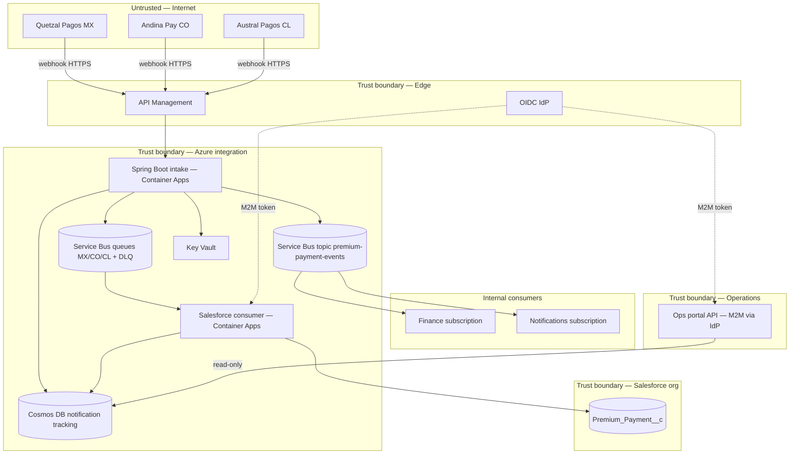
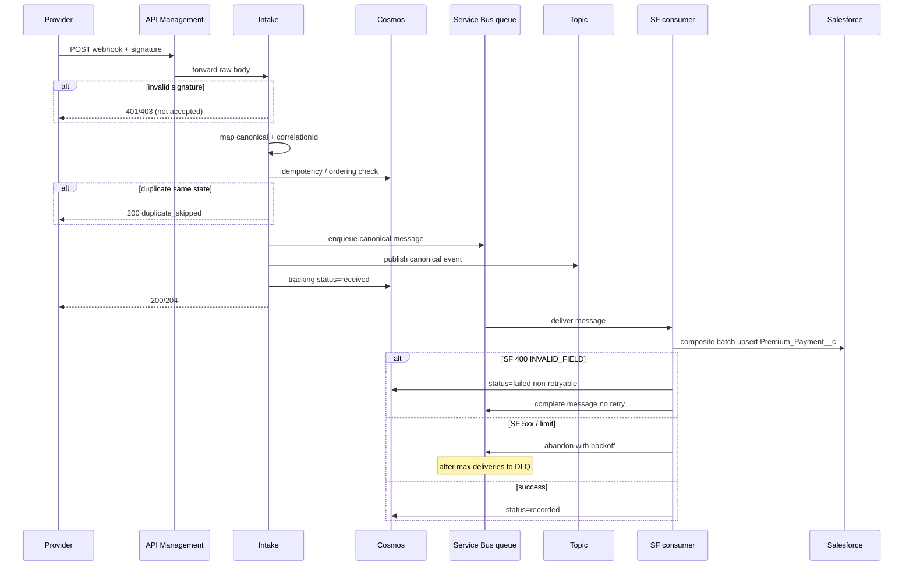

# Solution design — Premium Payment Notifications

## 1. Context diagram

**Trust notes:** Providers never call Salesforce or internal queues directly. Payer PII stops in intake (not logged, not in telemetry). Operations reads Cosmos via a dedicated API with RBAC — no production Key Vault or SF credentials on operator workstations.

## 2. Sequence — happy path and failures

## 3. Canonical payment event

**Schema:** `docs/api/events/premium-payment.schema.json` (version in `metadata.schemaVersion`).

| Field | Type | Description |
|---|---|---|
| `metadata.schemaVersion` | string | Semver of canonical schema (e.g. `1.0.0`) |
| `metadata.eventId` | string | Unique id for this canonical publication (UUID) |
| `metadata.correlationId` | string | End-to-end trace id |
| `metadata.country` | string | `MX`, `CO`, `CL` |
| `metadata.provider` | string | `Quetzal`, `Andina`, `Austral` |
| `metadata.acceptedAt` | string (ISO-8601) | When Meridian accepted the webhook |
| `payment.paymentKey` | string | Business key for Salesforce upsert (`Payment_Key__c`) |
| `payment.policyNumber` | string | Normalized `POL-{CC}-#########` |
| `payment.providerTransactionId` | string | Charge / transaccion / payment id |
| `payment.providerEventId` | string | Provider event or notification id |
| `payment.amount` | object | `{ "value": decimal string, "currency": ISO4217 }` |
| `payment.status` | enum | `Pending`, `Captured`, `Failed`, `Refunded` |
| `payment.statusChangedAt` | string (ISO-8601) | Provider state change time |
| `payment.paymentMethod` | string | Tokenised method label (no card data) |

### Provider mapping

| Provider | Source | Provider status / type | Canonical `status` | `paymentKey` | `statusChangedAt` | Amount |
|---|---|---|---|---|---|---|
| Quetzal | `type` | `charge.succeeded` | Captured | `QZ-{data.charge.id}` | `paid_at` or `created` | centavos → decimal MXN |
| Quetzal | `type` | `charge.failed` | Failed | `QZ-{data.charge.id}` | `created` | centavos → decimal |
| Quetzal | `type` | `charge.refunded` | Refunded | `QZ-{data.charge.id}` | `refunded_at` | centavos → decimal |
| Andina | `transaccion.estado` | `PENDIENTE` | Pending | `AN-{transaccion.id}` | `fecha_transaccion` | string major unit COP |
| Andina | | `APROBADA` | Captured | same | same | same |
| Andina | | `RECHAZADA` | Failed | same | same | same |
| Andina | | `REVERSADA` | Refunded | same | same | same |
| Austral | `eventType` | `PAYMENT_CONFIRMED` | Captured | `AU-{payment.paymentId}` | `payment.occurredAt` | integer CLP string |
| Austral | | `PAYMENT_REJECTED` | Failed | same | same | same |
| Austral | | `PAYMENT_REVERSED` | Refunded | same | same | same |

## 4. Idempotency and ordering (FR4, FR5)

### Idempotency keys

| Provider | Intake dedup key | Salesforce `Payment_Key__c` |
|---|---|---|
| Quetzal | Webhook event `id` (stable on retry) | `QZ-{charge.id}` |
| Andina | `{transaccion.id}:{estado}` for duplicate retries; `notificacion_id` stored as `providerEventId` | `AN-{transaccion.id}` |
| Austral | `eventId` | `AU-{paymentId}` |

### Enforcement

1. **Intake (Cosmos):** Document id `paymentKey`. Before enqueue, compare incoming `status` and `statusChangedAt` with stored record.
2. **Duplicate retry (same state, same or older timestamp):** respond `2xx`, Cosmos `duplicate_skipped`, **no** publish.
3. **Out-of-order older event:** skip publish; log metric `ordering.skipped`.
4. **Valid forward transition** (e.g. Captured → Refunded) or newer timestamp: publish and update Cosmos.
5. **Consumer (Salesforce):** upsert by `Payment_Key__c`; apply same monotonic rules using `Status_Changed_At__c` and `Last_Event_Id__c`.

### State machine (canonical)

Allowed transitions: `Pending` → any; `Captured` → `Refunded`; `Failed` terminal unless provider resends newer pending path (Andina PSE). Never apply `Refunded` then older `Captured`.

## 5. Error handling

| Stage | Retry? | DLQ? | Notes |
|---|---|---|---|
| Signature / schema | No | N/A | 4xx to provider (not accepted) |
| Enqueue failure | Provider retries | N/A | 5xx to provider |
| Consumer SF 5xx/401/lock | Yes, exponential backoff | After 10 deliveries | `MaxDeliveryCountExceeded` |
| Consumer SF 400 data | No | Optional ops queue | Mark `failed`, do not burn deliveries |
| SF 403 budget | Pause consumer + alert | Holds backlog | Throttle to protect org |

**Replay:** DLQ reprocessor (manual, approvals) reads messages, re-checks ordering in Cosmos, routes to main queue with new `correlationId` suffix `.replay`. Never replay without fixing root data cause.

## 6. Capacity (NFR1, NFR2, NFR5)

**Assumptions:** Peak 120,000 notifications/day ≈ 1.39 msg/s average; burst **40/s for 15 minutes**; duplicate rate 3%.

| Workload | Calculation | Result |
|---|---|---|
| Intake throughput | 40 rps × 3 countries worst case (burst per country ~18 rps MX) | Container Apps scale 3–20 replicas @ 512m CPU |
| API calls with batching | 120k notifs / 150 batch size | ~800 batch calls/day ≪ 150k budget |
| With 3% duplicates | 116k effective | ~773 batch calls |
| Headroom for retries | +30% | still &lt; 2,000 calls/day dedicated |
| Freshness | Batch flush 2–5s + SF p95 1.2s + queue lag &lt; 30s | 95% under 5 min achievable |

Consumer concurrency capped at **25** parallel SF requests; micro-batcher aggregates per country queue.

## 7. Data persisted outside Salesforce

**Cosmos container `notification-tracking`** (partition key `/country`):

| Field | Purpose |
|---|---|
| `id` | `paymentKey` |
| `correlationId` | NFR7 trace |
| `providerTransactionId`, `providerEventId` | FR7 lookup |
| `processingStatus` | `received`, `recorded`, `failed`, `duplicate_skipped`, `dead_lettered` |
| `canonicalStatus`, `statusChangedAt` | FR5 |
| `lastErrorCode`, `lastErrorAt` | Ops |
| `acceptedAt`, `recordedAt` | SLI freshness |
| TTL | 400 days (regulatory retention assumption) |

Secondary indexes / change feed → metric emitter for per-country freshness dashboards.

## 8. Operations (FR7)

1. **Lookup API** `GET /operations/v1/notifications?country=CO&transactionId=...` (APIM + IdP).
2. Returns processing timeline from Cosmos (no payer fields).
3. Links to Application Insights trace via `correlationId` (restricted role).
4. DLQ depth dashboards per country queue; alert threshold &gt; 100 messages.

Access: Azure RBAC group `Payments-Ops-Reader`, managed identity on ops service, no direct Cosmos keys on laptops.